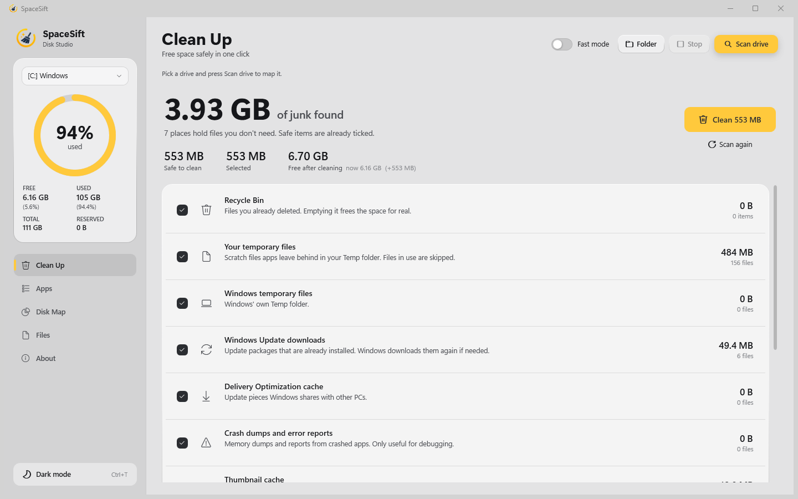
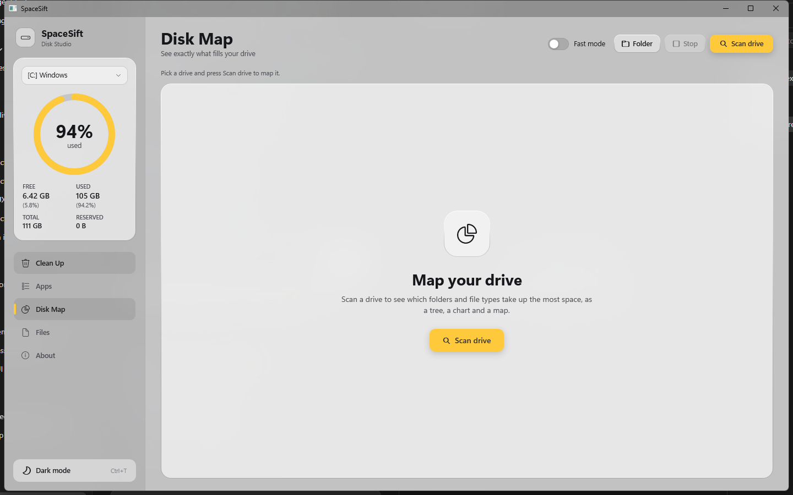

<p align="center">
  
</p>

<h1 align="center">SpaceSift</h1>

<p align="center">
  Find what fills your disk and free space safely.<br>
  For 64-bit Windows 10 (1809+) and Windows 11.
</p>

<p align="center">
  <a href="https://github.com/mercyblack011/SpaceSift/releases/latest"><b>Download the latest release</b></a>
</p>



## Download

Go to [Releases](https://github.com/mercyblack011/SpaceSift/releases/latest) and pick one:

| File | What it is |
|---|---|
| `SpaceSift-Setup-1.0.0-x64.exe` | **Installer.** Adds Start menu and desktop shortcuts and an uninstaller in Settings › Apps. Installs for your user without an admin prompt. |
| `SpaceSift-1.0.0-x64-portable.exe` | **Portable.** One file, runs without installing. |

No .NET install is needed; everything is included.

> Windows SmartScreen may warn the first time because the app isn't code-signed yet. Choose **More info › Run anyway**.

## Features

- **Clean Up**: finds junk (Recycle Bin, temp files, Windows Update cache, crash dumps, thumbnail and browser caches, developer caches, old installers) and cleans it in one click. Safe items are ticked for you.
- **Apps**: installed programs with icons and sizes. Select one to see every connected folder, shortcut and registry entry. Uninstall the program only, or the program **and** all its connected folders (moved to the Recycle Bin). Finds leftover folders from removed apps.
- **Disk Map**: folder tree sorted by size, file types as list / pie / donut, and a treemap where every block is a file. Double-click to zoom in.
- **Files**: every file on the drive with search, size and date filters, and file-type icons.
- **Fast mode**: reads the NTFS Master File Table directly (needs administrator rights) for a much faster scan.
- Right-click anything to open it, show it in Explorer, copy its path, see its properties, or delete it.

## Design

Apple-inspired: Windows 11 Acrylic glass, spring-physics motion, dark and light themes (Ctrl+T), and a gray / silver palette with yellow only on the key actions. It falls back to solid surfaces on Windows 10 or when Windows "Transparency effects" is off, and turns animations off when "Animation effects" is off.



## Build from source

Requirements: [.NET 8 SDK](https://dotnet.microsoft.com/download/dotnet/8.0) and, for the installer, [Inno Setup 6](https://jrsoftware.org/isinfo.php).

```bash
dotnet publish SpaceSift/SpaceSift.csproj -c Release -r win-x64 --self-contained true -p:PublishSingleFile=true -p:IncludeNativeLibrariesForSelfExtract=true -p:EnableCompressionInSingleFile=true -o publish
```

```bash
ISCC.exe installer/SpaceSift.iss
```

The portable exe lands in `publish/`, the installer in `dist/`.

## Project layout

```
SpaceSift/          WPF app (.NET 8, x64)
  Core/             scanners (folder + NTFS MFT), cleaner, installed apps, theme
  UI/               treemap, charts, ring gauge, spring motion
  Themes/           dark / light glass themes and control styles
  Assets/           logo and app icon
installer/          Inno Setup script
docs/               README images
```

## Credits

Link hover motion ported from [Skiper UI](https://skiper-ui.com) (skiper40).
